<div align="center">

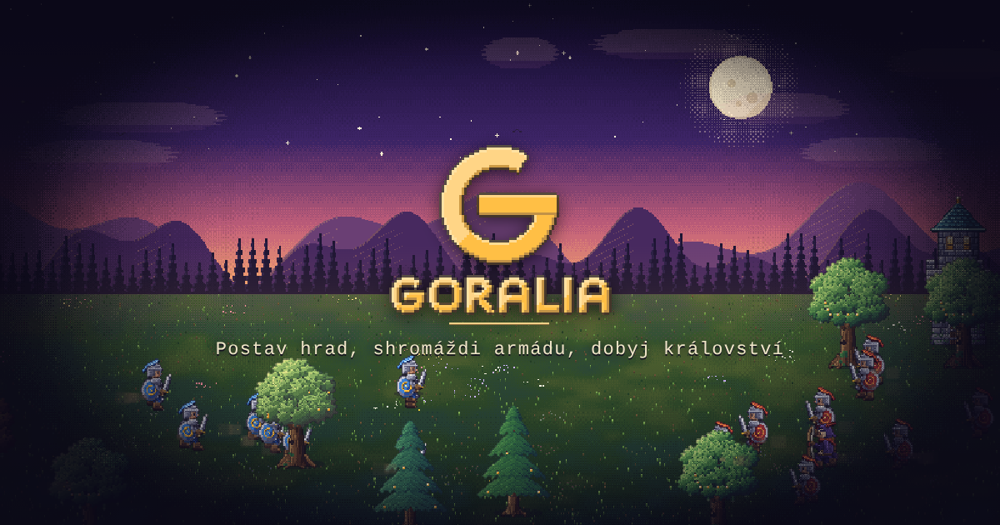

# ⚔️ Goralia

**Pixelová realtimová strategie v prohlížeči.** Postav hrad, shromáždi armádu, dobyj království.

[](https://goralia.cz)


</div>

---

<div align="center">
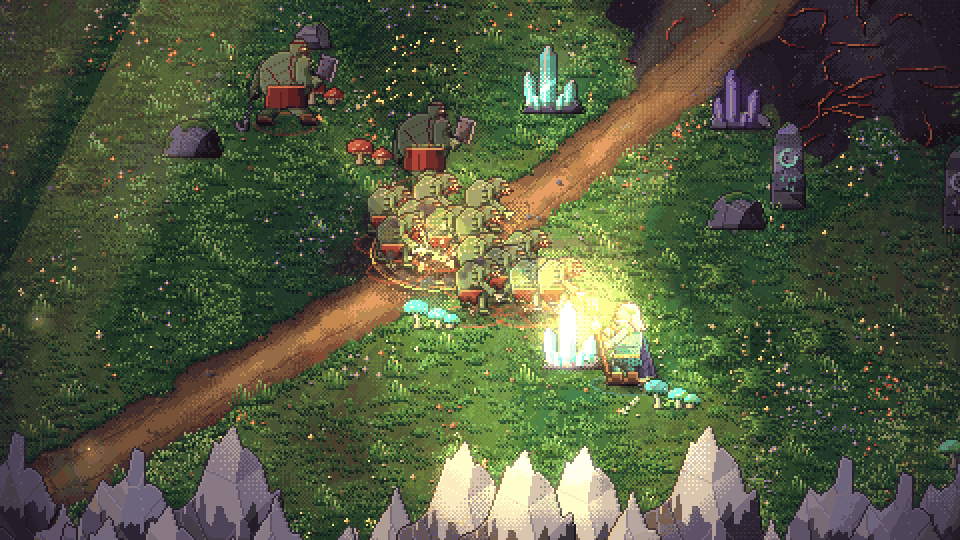
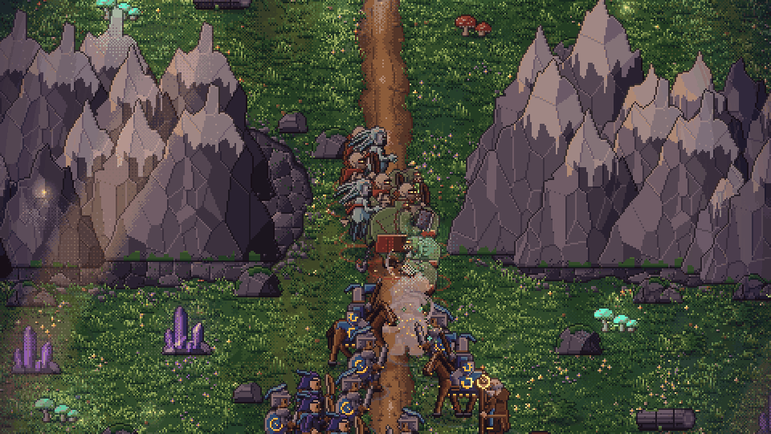
</div>

Goralia je klasická RTS ve stylu starých dobrých Warcraftů, jen celá v jednom okně prohlížeče. Dělníci těží zlato a kácí dřevo, z kasáren pochodují vojáci a lučištníci, rytíři najíždějí do nepřátel a katapulty bourají hradby. Hraje se proti AI nebo online s kamarády na mapách **až pro 16 hráčů**, a na kooperativních mapách společně proti **nemrtvým z pekla**.

Každý pixel ve hře je **nakreslený kódem**: jednotky, budovy, stromy, efekty, písmo i ikony. V repozitáři nejsou žádné obrázkové sprity, hudba je syntetizovaná přes Web Audio a podhalanská lidová muzika se mění podle toho, jestli je klid, nebo boj.

## 📜 Obsah

- [✨ Co ve hře najdeš](#-co-ve-hře-najdeš)
- [🛡️ Jednotky](#️-jednotky)
- [💀 Nemrtví z pekla](#-nemrtví-z-pekla)
- [🏰 Budovy](#-budovy)
- [⚒️ Výzkumy](#️-výzkumy)
- [🗺️ Mapy](#️-mapy)
- [🌗 Světlo, stíny a denní doba](#-světlo-stíny-a-denní-doba)
- [🌐 Multiplayer, účty a komunita](#-multiplayer-účty-a-komunita)
- [🧭 Editor map](#-editor-map)
- [🛠️ Panel serveru pro admina](#️-panel-serveru-pro-admina)
- [⌨️ Ovládání](#️-ovládání)
- [🚀 Spuštění](#-spuštění)
- [🧱 Jak je to postavené](#-jak-je-to-postavené)

---

## ✨ Co ve hře najdeš

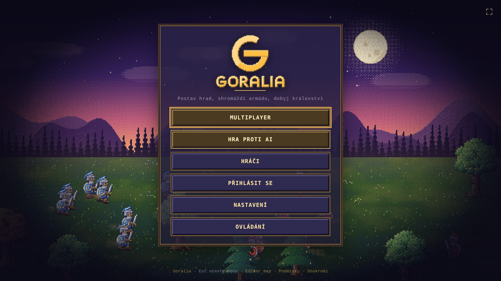

- 🏹 **7 hratelných jednotek** od dělníka po katapult a hrdina, který sbírá zkušenosti a umí ohnivou kouli i léčení
- 🏰 **7 budov** hráče a **5 pekelných budov** nemrtvých
- ⚒️ **5 výzkumů** v kovárně a gmině, každý v několika stupních
- 💀 **Kooperativní režim** proti AI frakci nemrtvých, která roste a útočí ve vlnách
- 🗺️ **13 map** pro 2 až 16 hráčů a vlastní mapy z editoru
- 🌐 **Online multiplayer** s místnostmi, chatem a **hlasovým chatem** (push‑to‑talk)
- 🤖 **Hra proti AI**, která hraje podle stejných pravidel jako člověk
- 🏆 **Síň slávy**, **turnaje** s odpočtem a přihlášením, profily a statistiky zápasů
- 🌗 **WebGL světla a stíny**, střídání dne a noci, odrazy ve vodě, sluneční paprsky
- 🗣️ **České hlášky jednotek** při výběru a rozkazu
- 🎻 Vlastní syntetizovaná **podhalanská muzika**
- 📱 Funguje na počítači, tabletu i mobilu, klávesy jdou přemapovat

<br clear="right">

<div align="center">
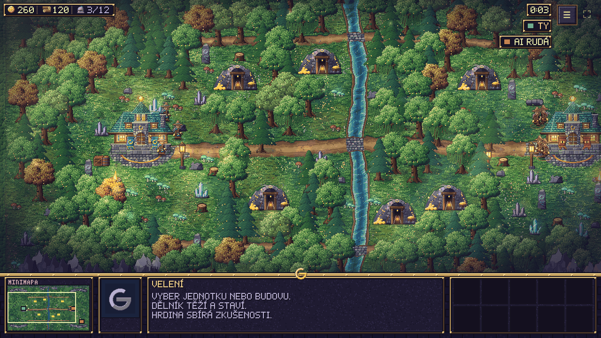
<br><sub><i>Údolí potoka: dvě gminy, zlaté doly, potok s brody a HUD s minimapou</i></sub>
</div>

---

## 🛡️ Jednotky

Každá jednotka má vlastní ručně „nakódovanou“ animaci chůze, útoku, smrti a zásahu. Všechno se kreslí na jemné pixelové mřížce a peče se při načítání hry.

<table>
<tr>
<td align="center" width="25%">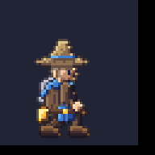<br><b>⛏️ Dělník</b></td>
<td align="center" width="25%">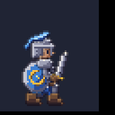<br><b>🛡️ Voják</b></td>
<td align="center" width="25%">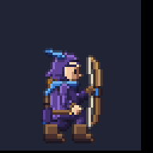<br><b>🏹 Lučištník</b></td>
<td align="center" width="25%">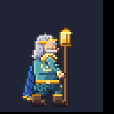<br><b>✨ Hrdina</b></td>
</tr>
<tr>
<td valign="top"><sub>Těží zlato, kácí dřevo, staví a opravuje budovy. Nosí náklad na zádech.</sub></td>
<td valign="top"><sub>Pěšák se štítem a mečem, páteř každé armády.</sub></td>
<td valign="top"><sub>Střílí z dálky, s výzkumem Střelba víc a dál.</sub></td>
<td valign="top"><sub>Sbírá zkušenosti a úrovně. Umí <b>ohnivou kouli</b> (A) a <b>léčení</b> (S).</sub></td>
</tr>
<tr>
<td align="center">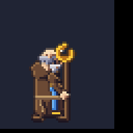<br><b>🙏 Mnich</b></td>
<td align="center">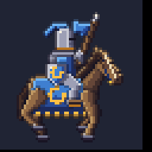<br><b>🐎 Rytíř</b></td>
<td align="center">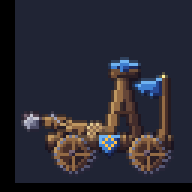<br><b>🪨 Katapult</b></td>
<td></td>
</tr>
<tr>
<td valign="top"><sub>Léčí zraněné spojence v okolí požehnáním.</sub></td>
<td valign="top"><sub>Rychlý jezdec. Po rozjezdu přidá první ranou bonus za <b>nápor</b>.</sub></td>
<td valign="top"><sub>Kámen dopadne na plochu, budovám ubere 2,5× víc. Zblízka střílet neumí.</sub></td>
<td></td>
</tr>
</table>

| Jednotka | Kde | 🪙 Zlato | 🪵 Dřevo | ❤️ Životy | ⚔️ Útok | 🎯 Dosah | 👟 Rychlost |
|---|---|--:|--:|--:|--:|--:|--:|
| Dělník | Gmina | 50 | 0 | 65 | 6 | 22 | 55 |
| Voják | Kasárna | 65 | 15 | 110 | 15 | 25 | 45 |
| Lučištník | Kasárna | 80 | 30 | 70 | 11 | 110 | 49 |
| Hrdina | Kasárna | 150 | 50 | 210 | 23 | 34 | 53 |
| Mnich | Kasárna | 75 | 25 | 60 | 4 *(léčí 12)* | 90 | 48 |
| Rytíř | Stáj | 135 | 45 | 190 | 18 *(+14 nápor)* | 27 | 72 |
| Katapult | Dílna | 150 | 110 | 130 | 34 *(plošně)* | 200 | 30 |

<div align="center">
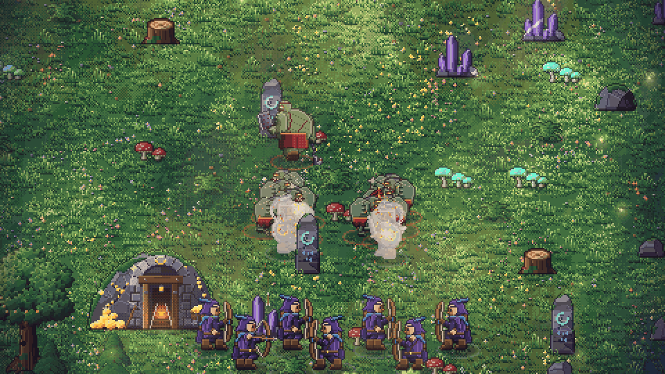
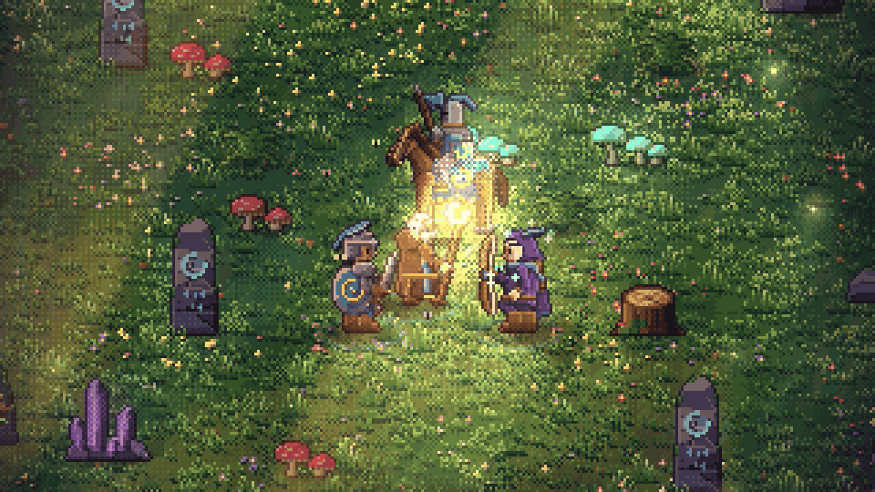
<br><sub><i>Salva lučištníků a mnich, který po boji léčí raněné</i></sub>
</div>

---

## 💀 Nemrtví z pekla

Na kooperativních mapách (třeba **Brána pekel**) stojí hráči v jednom týmu proti AI frakci nemrtvých. Ta nemá ekonomiku: její budovy samy chrlí jednotky, Nekropole a zikkuraty střílí, pevnost se časem rozrůstá a v **sílících vlnách** útočí na základny hráčů. Z Nekropole jednou povstane **Pekelný lich** s pekelným výbuchem.

<table>
<tr>
<td align="center">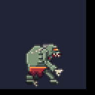<br><b>Ghúl</b><br><sub>rychlý a hladový</sub></td>
<td align="center">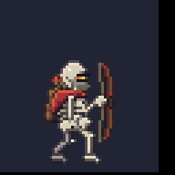<br><b>Kostlivý střelec</b><br><sub>luk z kostí</sub></td>
<td align="center">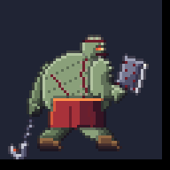<br><b>Zrůda</b><br><sub>300 životů a řetěz</sub></td>
<td align="center">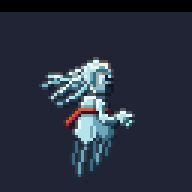<br><b>Přízrak</b><br><sub>útočí z dálky</sub></td>
<td align="center">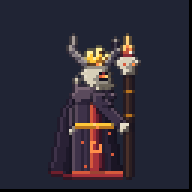<br><b>Pekelný lich</b><br><sub>boss s 800 životy</sub></td>
</tr>
</table>

<div align="center">
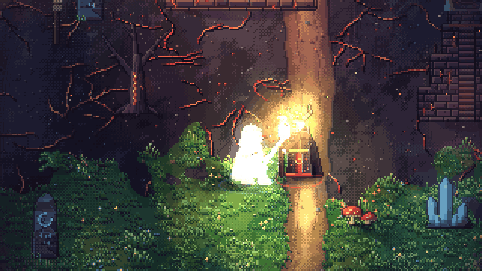
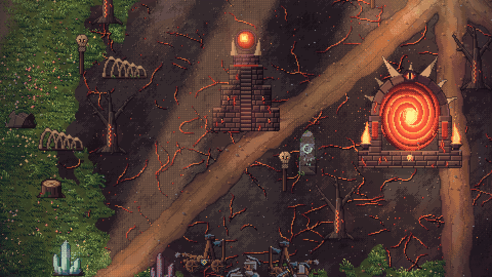
<br><sub><i>Souboj hrdiny s lichem u pekelné brány a katapulty, které srazí hořící zikkurat</i></sub>
</div>

---

## 🏰 Budovy

<div align="center">
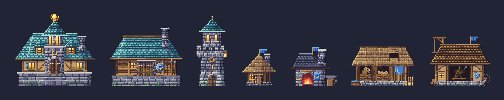
<br><sub><i>Gmina · Kasárna · Strážní věž · Buda · Kovárna · Stáj · Dílna</i></sub>
</div>

| Budova | 🪙 | 🪵 | Co umí |
|---|--:|--:|---|
| **Gmina** | – | – | Hlavní budova. Cvičí dělníky, zkoumá Nástroje a Opevnění. Kdo o ni přijde, prohrál. |
| **Kasárna** | 125 | 70 | Voják, lučištník, hrdina a mnich. |
| **Strážní věž** | 90 | 55 | Sama střílí po nepřátelích. Nahoře vlaje vlajka v barvě týmu. |
| **Buda** | 70 | 40 | Zvedne limit jednotek o 5 (až na 60). |
| **Kovárna** | 120 | 80 | Výzkumy Zbroj, Zbraně a Střelba. |
| **Stáj** | 140 | 90 | Rytíři. Potřebuje kasárna. |
| **Dílna** | 150 | 95 | Katapulty. Potřebuje kasárna. |

Dělník staví i **opravuje** poškozené budovy (za trochu zlata a dřeva). Rozestavěná budova se ukáže jako průsvitná modrá předloha a zničená se zřítí v oblaku prachu na trosky.

<div align="center">
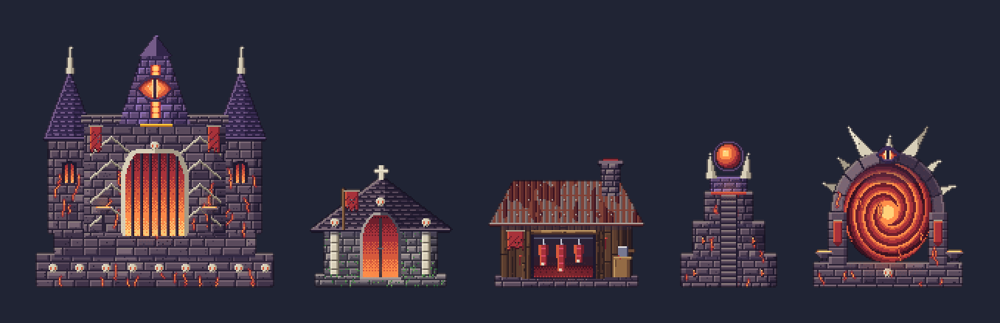
<br><sub><i>Pekelná pevnost: Nekropole · Krypta · Jatka · Zikkurat · Pekelná brána</i></sub>
</div>

<table>
<tr>
<td align="center">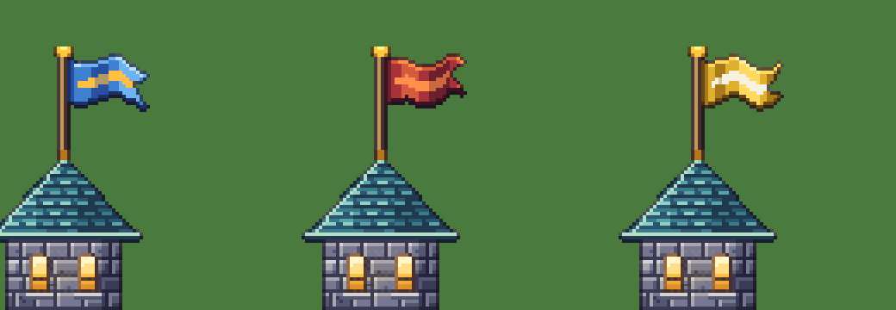<br><sub>Vlajky týmů na strážních věžích</sub></td>
<td align="center">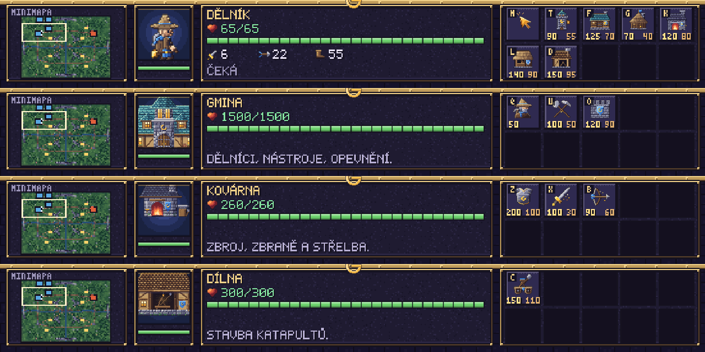<br><sub>HUD: minimapa, portrét, životy a příkazy s cenou</sub></td>
</tr>
</table>

---

## ⚒️ Výzkumy

Výzkum platí pro celý tým, i pro jednotky vycvičené později. Jedna budova zkoumá jednu věc najednou.

| Výzkum | Kde | Stupně | Efekt za stupeň |
|---|---|:-:|---|
| 🛡️ **Zbroj** | Kovárna | 3 | vojáci a rytíři dostanou o 12 % menší poškození |
| 🗡️ **Zbraně** | Kovárna | 3 | vojáci a rytíři +3 k poškození |
| 🏹 **Střelba** | Kovárna | 3 | lučištníci +2 k poškození a +10 k dosahu |
| 🔨 **Nástroje** | Gmina | 2 | dělníci natěží náklad o 18 % rychleji |
| 🧱 **Opevnění** | Gmina | 2 | budovy +15 % životů, věže +4 k poškození |

---

## 🗺️ Mapy

13 vestavěných map pro 2 až 16 hráčů. Přes řeky se chodí jen po brodech, hory a hradby tvoří přirozené průsmyky a o neutrální zlaté doly se bojuje. Další mapy se dají nakreslit v [editoru](#-editor-map).

<table>
<tr>
<td align="center" width="33%">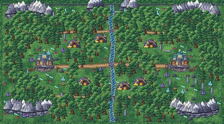<br><b>Údolí potoka</b> · 2 hráči<br><sub>Klidné údolí rozdělené potokem, rychlý souboj.</sub></td>
<td align="center" width="33%">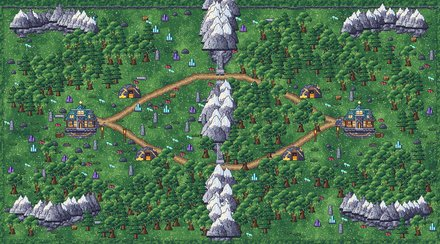<br><b>Horský průsmyk</b> · 2 hráči<br><sub>Pohoří napůl, jen dva průsmyky s branami.</sub></td>
<td align="center" width="33%">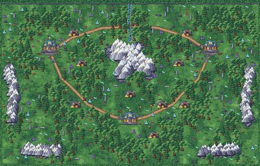<br><b>Pustá vysočina</b> · 3 hráči<br><sub>Tři království kolem hlubokého masivu.</sub></td>
</tr>
<tr>
<td align="center">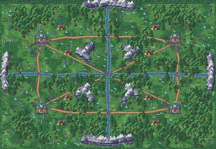<br><b>Čtyři koruny</b> · 4 hráči<br><sub>Řeka ve tvaru kříže a horské hřebeny.</sub></td>
<td align="center">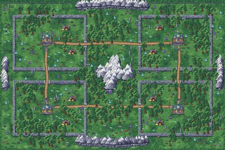<br><b>Hradby</b> · 4 hráči<br><sub>Čtyři opevněné tvrze, dovnitř jen branami.</sub></td>
<td align="center">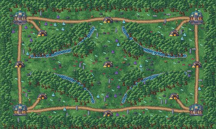<br><b>Čtyři řeky</b> · 4 hráči<br><sub>Mapa nakreslená v editoru.</sub></td>
</tr>
<tr>
<td align="center">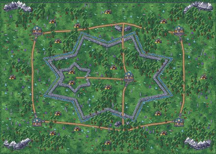<br><b>Pevnost Šance</b> · 5 hráčů<br><sub>Hradební hvězda s příkopem, obránce proti čtyřem.</sub></td>
<td align="center">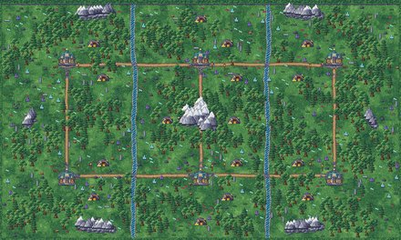<br><b>Šest říší</b> · 6 hráčů<br><sub>Pláň rozdělená dvěma řekami.</sub></td>
<td align="center">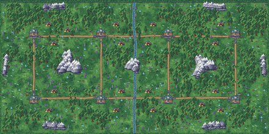<br><b>Osm království</b> · 8 hráčů<br><sub>Dvě řady království a řeka s brody.</sub></td>
</tr>
<tr>
<td align="center">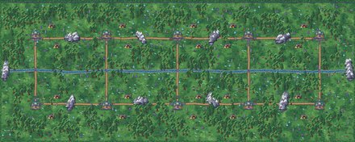<br><b>Deset říší</b> · 10 hráčů<br><sub>Dlouhý pás dvou řad podél řeky.</sub></td>
<td align="center">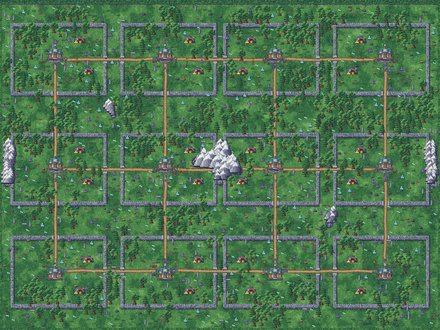<br><b>Dvanáct pevností</b> · 12 hráčů<br><sub>Opevněná království, hory uprostřed.</sub></td>
<td align="center">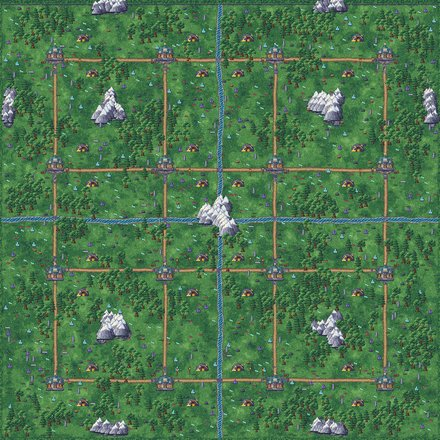<br><b>Velká válka</b> · 16 hráčů<br><sub>Mřížka 4×4 a dvě křížící se řeky.</sub></td>
</tr>
</table>

> 💀 **Brána pekel** (kooperace, 3 hráči + nemrtví): na severu za horami se rozpíná spálená pevnost s Nekropolí, která útočí v sílících vlnách.

---

## 🌗 Světlo, stíny a denní doba

Nad hotovým obrazem světa běží **WebGL 2 shadery**: každá lucerna, oheň, ohnivá koule nebo lich osvětlí okolí a jednotky, stromy i budovy z něj vrhají stíny. Během zápasu se střídá **den, soumrak, noc a úsvit**, v noci je opravdu tma a vidět jsou hlavně světla. Ve vodě se zrcadlí všechno, co stojí na břehu, a lesem prochází jemné sluneční paprsky.

<div align="center">
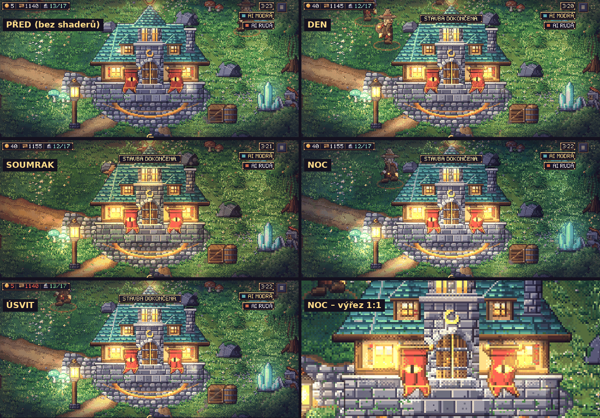
<br><sub><i>Stejná gmina bez shaderů, ve dne, za soumraku, v noci a za úsvitu</i></sub>
</div>

<table>
<tr>
<td align="center" width="50%">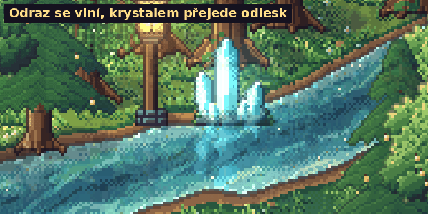<br><sub>Odrazy postav a stromů ve vodě</sub></td>
<td align="center" width="50%">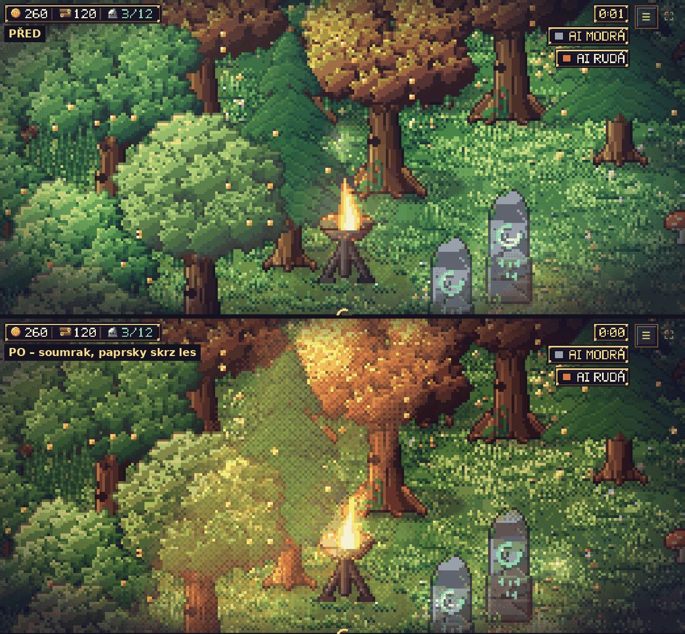<br><sub>Táborák a sluneční paprsky v lese</sub></td>
</tr>
<tr>
<td align="center">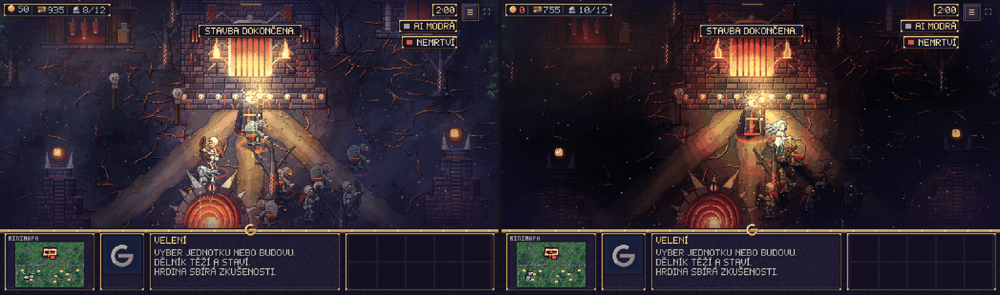<br><sub>Hluboká noc u pekelné brány</sub></td>
<td align="center">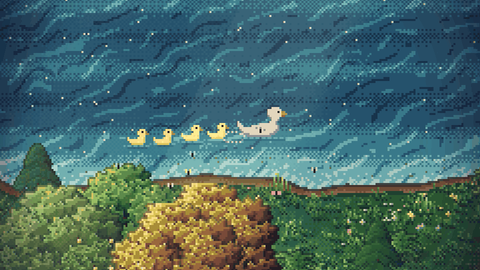<br><sub>A taky kachničky 🦆</sub></td>
</tr>
</table>

---

## 🌐 Multiplayer, účty a komunita

- 🏠 **Místnosti s hostitelem**: hostitel vybere mapu, pozve kamarády a volná místa doplní AI.
- 🔒 **Autoritativní server**: klient posílá jen záměry (rozkazy, stavbu, kouzla) a celou simulaci počítá server, takže nejde podvádět.
- 💬 **Chat** v lobby i během zápasu.
- 🎙️ **Hlasový chat** přes WebRTC: drž **V** a mluv. Zvuk jde přímo mezi prohlížeči, server jen předává signalizaci.
- 👤 **Účty** heslem, přes **Google** nebo **Facebook**, profily hráčů s historií zápasů a grafy průběhu.
- 👁️ **Divácký režim**: rozehraný zápas jde sledovat jako divák a vidět celou mapu.

<table>
<tr>
<td align="center" width="50%">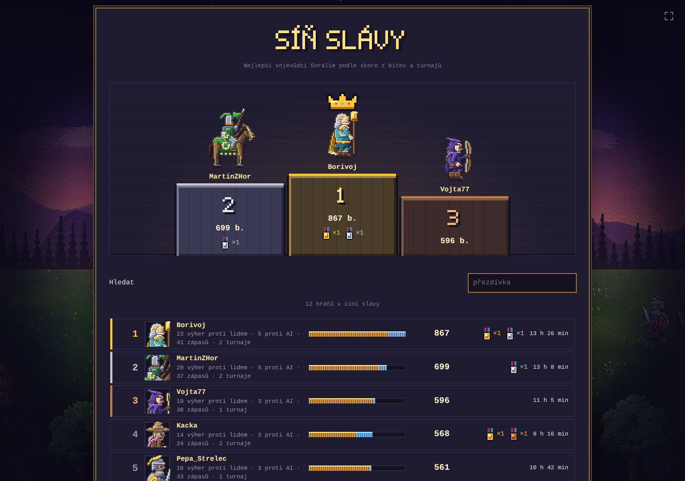<br><b>🏆 Síň slávy</b><br><sub>Stupně vítězů s postavičkami ze hry, žebříček, medaile z turnajů</sub></td>
<td align="center" width="50%">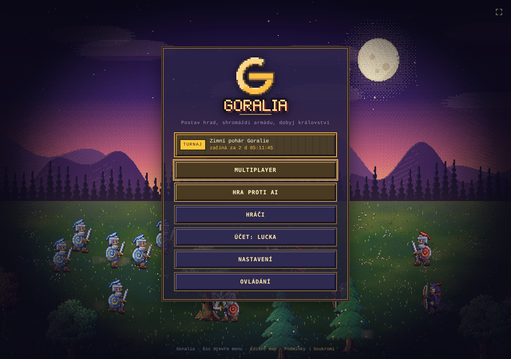<br><b>🎪 Turnaje</b><br><sub>Odpočet v hlavním menu, přihlášení a seznam hráčů</sub></td>
</tr>
</table>

---

## 🧭 Editor map

Vlastní mapy se kreslí přímo v prohlížeči na `/editor`: štětce pro **vodu, hory, hradby, cesty, stromy, doly a základny**, symetrie podle os a průběžná **kontrola hratelnosti**, která česky řekne, co mapě chybí. Uložená mapa se hned objeví mezi ostatními a admin ji může pro multiplayer zapnout nebo vypnout. Editor zvládne i mapy 10 000 × 10 000 jednotek.

<div align="center">
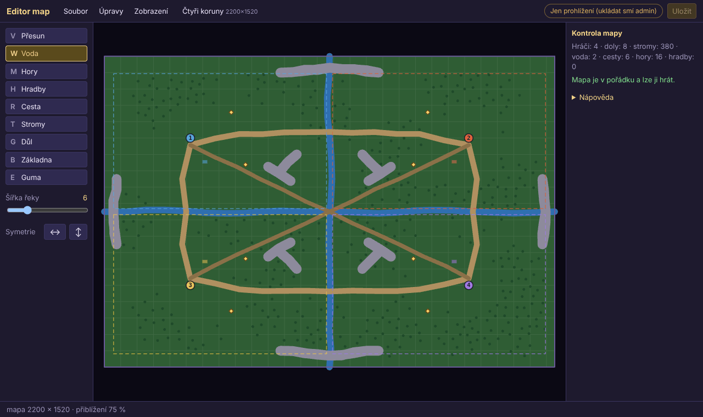
</div>

---

## 🛠️ Panel serveru pro admina

Na `/admin.html` má admin přehled o celém serveru: návštěvnost, živé místnosti, odehrané zápasy, správa hráčů a map, plánování turnajů a záznam akcí admina.

- 🌍 **Odkud se hráči připojují**: mapa světa a tabulka zemí a měst, zjištěno offline z lokální GeoIP databáze (IP adresy se nikam neposílají ani neukládají).
- 🔗 **Odkud přišli**: zdroje návštěv (vyhledávače, sociální sítě, odkazy, `utm_` kampaně), počítané po dnech.
- ⏱️ **Odehraný čas** hráčů v multiplayeru, proti AI i online.
- ⌨️ **Příkazový řádek** ve hře (klávesa `/`): `/spawn knight 5`, `/resources`, `/speed 10`, `/god`, `/tech` a další pro testování. Zápas s příkazem se nepočítá do statistik.

<table>
<tr>
<td align="center" width="50%">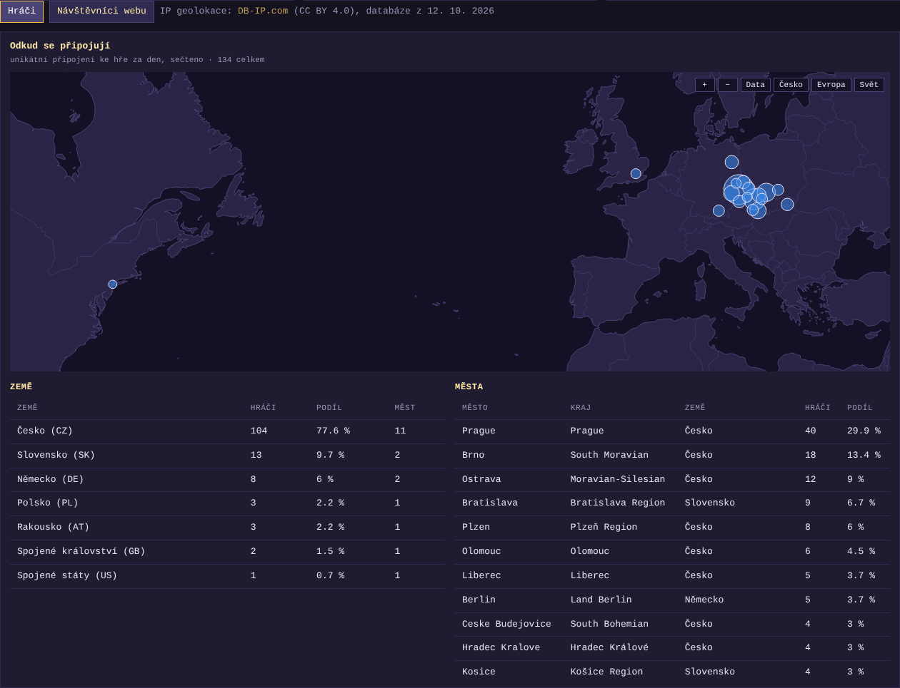<br><sub>Odkud se hráči připojují</sub></td>
<td align="center" width="50%">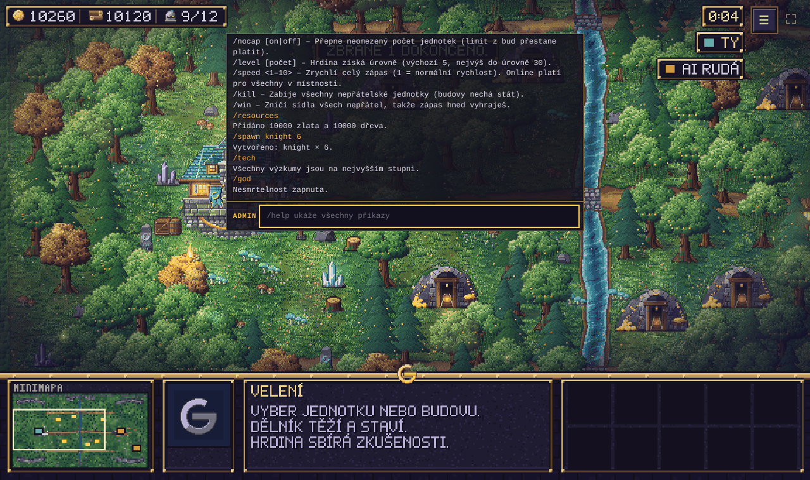<br><sub>Příkazový řádek admina ve hře</sub></td>
</tr>
</table>

---

## ⌨️ Ovládání

Myš: levé tlačítko vybírá (i tažením), pravé posílá rozkazy, kolečko přibližuje, prostřední tlačítko posouvá mapu. Na dotykovém displeji to jde prsty. **Všechny klávesy jdou v Nastavení přemapovat.**

| Jednotky | | Stavby | | Výzkum a kouzla | | Ostatní | |
|---|:-:|---|:-:|---|:-:|---|:-:|
| Dělník | `Q` | Strážní věž | `T` | Zbroj | `Z` | Menu / pauza | `P` `Esc` |
| Voják | `W` | Kasárna | `F` | Zbraně | `X` | Chat | `Enter` |
| Lučištník | `E` | Buda | `G` | Střelba | `B` | Hlasový chat | `V` (držet) |
| Hrdina | `H` | Kovárna | `K` | Nástroje | `U` | Kamera | šipky |
| Mnich | `N` | Stáj | `L` | Opevnění | `O` | Skupina | `Ctrl` + číslo |
| Rytíř | `J` | Dílna | `D` | Ohnivá koule | `A` | Další typ ve výběru | `Tab` |
| Katapult | `C` | | | Léčení | `S` | Příkazy admina | `/` |

---

## 🚀 Spuštění

Potřebuješ [Node.js](https://nodejs.org).

```bash
npm install
npm start            # web na http://localhost:3000, hra na /play (port z proměnné PORT)
npm test             # testy map, simulace, serveru a účtů
```

Další užitečné příkazy:

| Příkaz | Co dělá |
|---|---|
| `npm run admin:reset` | nové heslo admina (při zastaveném serveru) |
| `npm run voices` | vyrobí hlášky jednotek do `assets/voices` |
| `npm run geoip` | stáhne nebo aktualizuje GeoIP databázi pro mapu připojení |

Nastavení serveru patří do souboru `.env` v kořeni projektu: `cp .env.example .env` a doplň hodnoty (vzor [.env.example](.env.example) obsahuje všechny proměnné). Proměnné z prostředí mají před `.env` přednost.

Přihlášení přes Google a Facebook se zapne proměnnými `GOOGLE_CLIENT_ID` / `GOOGLE_CLIENT_SECRET` a `FACEBOOK_APP_ID` / `FACEBOOK_APP_SECRET`. Pro hlasový chat za přísným NATem pomůže vlastní TURN server (`GORALIA_TURN_URL`, `GORALIA_TURN_USER`, `GORALIA_TURN_PASS`). Podrobnosti k nasazení s pm2 jsou v [HELP.txt](HELP.txt).

---

## 🧱 Jak je to postavené

```
uvod.html         úvodní stránka webu na / (js/web.js, css/web.css, média v assets/web)
index.html        hra na /play (menu, lobby, zápas)
editor.html       editor map
admin.html        panel serveru
js/               klient i sdílená logika (globální jmenný prostor PK)
server/           Node server: HTTP, WebSocket místnosti, účty, statistiky
maps/             vestavěné mapy ve formátu goralia-map (JSON)
assets-export/    export veškeré grafiky do PNG a spritesheetů (Aseprite JSON)
```

- **Sdílená simulace**: `js/sim.js`, `js/rules.js`, `js/nav.js` (A\*) a `js/ai.js` běží na serveru při online hře i v prohlížeči při hře proti AI. Klient dostává v obou režimech stejné snímky.
- **Procedurální pixel art**: `js/units.js`, `js/buildings.js`, `js/props.js`, `js/world.js`, `js/fx.js` kreslí všechno kódem na jemné mřížce. Celá grafika jde vyexportovat do PNG, viz [assets-export](assets-export/README.md).
- **Grafika**: `js/shaders.js` (WebGL 2 světla, stíny, bloom), `js/hud.js` (kamenný HUD s mosazí), `js/font.js` (bitmapové písmo s českou diakritikou).
- **Zvuk**: `js/audio.js` (zvukové efekty přes Web Audio), `js/music.js` (podhalanská muzika), `js/voice.js` (hlášky jednotek).
- **Online**: `server/server.js` (místnosti a zápasy přes `ws`), `js/voicechat.js` (WebRTC), `server/accounts.js` a `server/oauth.js` (účty).

<div align="center">

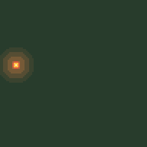
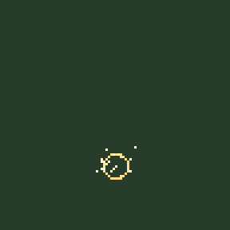
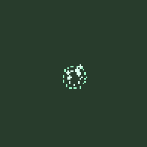


**[▶ Hraj na goralia.cz](https://goralia.cz)**

</div>
